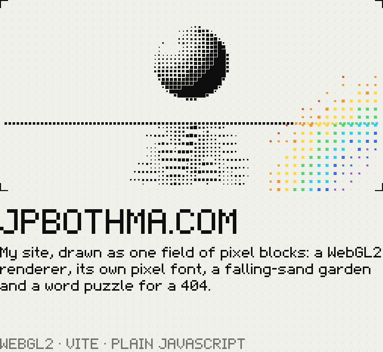
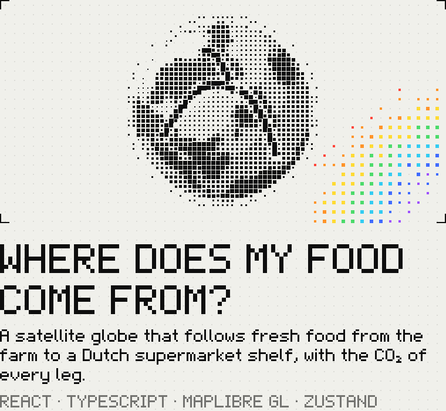
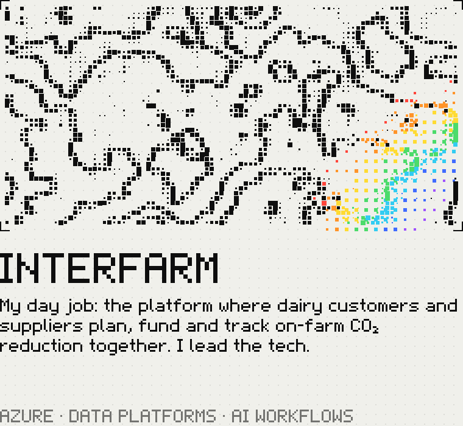
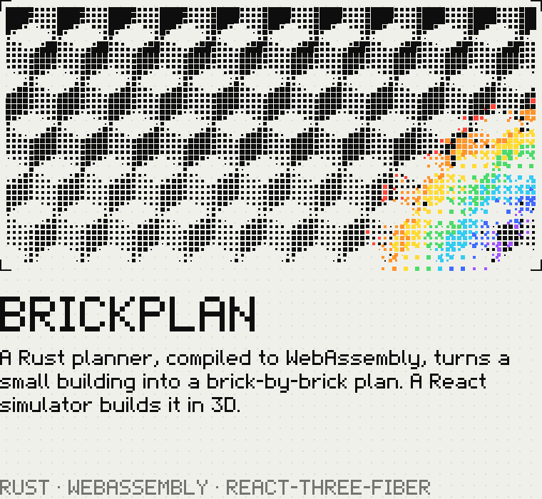
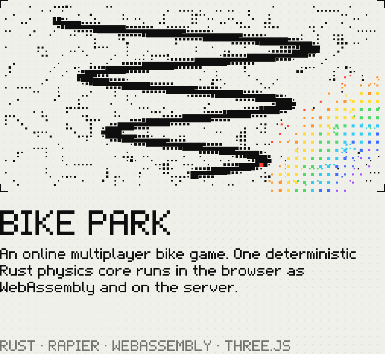
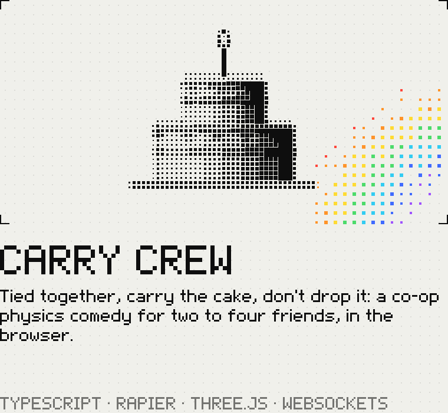

<!-- Drawn with the parts of jpbothma.com: scripts/draw.mjs makes the pictures, scripts/garden.mjs looks after the garden. -->
<a href="https://jpbothma.com">
  <picture>
    <source media="(prefers-color-scheme: dark)" srcset="assets/header-dark.svg">
    
  </picture>
</a>

I'm JP, a South African creative technologist living in Amsterdam. By day I'm Tech Lead of Sustainability at [Interfood](https://jpbothma.com/work/interfarm/), turning dairy customers' climate targets into work on actual farms. Around that I build interactive worlds and games, make data legible, and ship AI agents that quietly take care of the repetitive, so people keep the parts that need a human. I'd like to build more of that: human-centred systems in a world of agents, and technology that brings people a little closer to nature.

**[jpbothma.com](https://jpbothma.com)** · [CV](https://jpbothma.com/cv/) · [LinkedIn](https://www.linkedin.com/in/jp-bothma) · [Work with me](https://jpbothma.com/services/)

## ■ Selected work

<table>
  <tr>
    <td width="50%" valign="top">
      <a href="https://jpbothma.com"><picture><source media="(prefers-color-scheme: dark)" srcset="assets/work-site-dark.png"></picture></a>
       <b><a href="https://jpbothma.com">Live ↗</a></b> · <a href="https://github.com/JP-Alchemy/CV">Code</a> · <a href="https://jpbothma.com/colophon/">How it's made</a>
    </td>
    <td width="50%" valign="top">
      <a href="https://wheredoesmyfood.com"><picture><source media="(prefers-color-scheme: dark)" srcset="assets/work-food-dark.png"></picture></a>
       <b><a href="https://wheredoesmyfood.com">Live ↗</a></b> · <a href="https://github.com/JP-Alchemy/co2-map">Code</a>
    </td>
  </tr>
  <tr>
    <td width="50%" valign="top">
      <a href="https://jpbothma.com/work/interfarm/"><picture><source media="(prefers-color-scheme: dark)" srcset="assets/work-interfarm-dark.png"></picture></a>
       <b><a href="https://jpbothma.com/work/interfarm/">Case study ↗</a></b> · the code is private (it's the day job)
    </td>
    <td width="50%" valign="top">
      <a href="https://jp-alchemy.github.io/brickplan/"><picture><source media="(prefers-color-scheme: dark)" srcset="assets/work-brickplan-dark.png"></picture></a>
       <b><a href="https://jp-alchemy.github.io/brickplan/">Live ↗</a></b> · <a href="https://github.com/JP-Alchemy/brickplan">Code</a>
    </td>
  </tr>
  <tr>
    <td width="50%" valign="top">
      <a href="https://github.com/JP-Alchemy/bike-park"><picture><source media="(prefers-color-scheme: dark)" srcset="assets/work-bike-park-dark.png"></picture></a>
       <b><a href="https://github.com/JP-Alchemy/bike-park">Code</a></b> · <a href="https://github.com/JP-Alchemy/bike-park/blob/main/docs/game-design-document.md">Design document</a>
    </td>
    <td width="50%" valign="top">
      <a href="https://github.com/JP-Alchemy/carry-crew"><picture><source media="(prefers-color-scheme: dark)" srcset="assets/work-carry-crew-dark.png"></picture></a>
       <b><a href="https://github.com/JP-Alchemy/carry-crew">Code</a></b> · a playable prototype
    </td>
  </tr>
</table>

Also on here: Unreal Engine 5 [marble games](https://github.com/JP-Alchemy/UE5_MarbleGames), a [tank game](https://github.com/JP-Alchemy/UE5_Tanker) and a [top-down shooter](https://github.com/JP-Alchemy/UE5_TopDownShooter), [shader experiments](https://github.com/JP-Alchemy/ShaderExperiments), a [Three.js playground](https://github.com/JP-Alchemy/ThreeJS-Playground), a [Discord attendance bot](https://github.com/JP-Alchemy/Discord-Attendance-Tracker) and a site for [Lady Jane](https://ladyjanetattoo.com), a tattoo and fine-art studio in Tel Aviv. Live elsewhere: [SwarmFort.io](https://swarmfort.io), [nezen.io](https://nezen.io) and [What the Duck](https://wtd.jpbothma.com).

## ■ Leave a flower

<!-- garden -->
<picture>
  <source media="(prefers-color-scheme: dark)" srcset="assets/garden-dark.svg?v=1">
  
</picture>

**1 flower planted so far.** Newest: [@JP-Alchemy](https://github.com/JP-Alchemy) (violet).
<!-- /garden -->

Pick a colour to plant one. It opens an issue with everything filled in: press **Submit new issue**, and in about a minute a GitHub Action plants your flower here with your name on it.

<!-- seeds -->

<a href="https://github.com/JP-Alchemy/JP-Alchemy/issues/new?title=garden%3A%20plant%20red&body=Press%20**Submit%20new%20issue**%20and%20a%20GitHub%20Action%20plants%20a%20red%20flower%20in%20the%20garden%20on%20my%20profile%2C%20with%20your%20name%20on%20it.%20It%20takes%20about%20a%20minute%2C%20then%20this%20issue%20closes%20itself.%0A%0AOne%20flower%20per%20person%20a%20day.%20The%20garden%20keeps%20the%20newest%2024."><picture><source media="(prefers-color-scheme: dark)" srcset="assets/seed-red-dark.svg"></picture></a>
<a href="https://github.com/JP-Alchemy/JP-Alchemy/issues/new?title=garden%3A%20plant%20orange&body=Press%20**Submit%20new%20issue**%20and%20a%20GitHub%20Action%20plants%20a%20orange%20flower%20in%20the%20garden%20on%20my%20profile%2C%20with%20your%20name%20on%20it.%20It%20takes%20about%20a%20minute%2C%20then%20this%20issue%20closes%20itself.%0A%0AOne%20flower%20per%20person%20a%20day.%20The%20garden%20keeps%20the%20newest%2024."><picture><source media="(prefers-color-scheme: dark)" srcset="assets/seed-orange-dark.svg"></picture></a>
<a href="https://github.com/JP-Alchemy/JP-Alchemy/issues/new?title=garden%3A%20plant%20yellow&body=Press%20**Submit%20new%20issue**%20and%20a%20GitHub%20Action%20plants%20a%20yellow%20flower%20in%20the%20garden%20on%20my%20profile%2C%20with%20your%20name%20on%20it.%20It%20takes%20about%20a%20minute%2C%20then%20this%20issue%20closes%20itself.%0A%0AOne%20flower%20per%20person%20a%20day.%20The%20garden%20keeps%20the%20newest%2024."><picture><source media="(prefers-color-scheme: dark)" srcset="assets/seed-yellow-dark.svg"></picture></a>
<a href="https://github.com/JP-Alchemy/JP-Alchemy/issues/new?title=garden%3A%20plant%20green&body=Press%20**Submit%20new%20issue**%20and%20a%20GitHub%20Action%20plants%20a%20green%20flower%20in%20the%20garden%20on%20my%20profile%2C%20with%20your%20name%20on%20it.%20It%20takes%20about%20a%20minute%2C%20then%20this%20issue%20closes%20itself.%0A%0AOne%20flower%20per%20person%20a%20day.%20The%20garden%20keeps%20the%20newest%2024."><picture><source media="(prefers-color-scheme: dark)" srcset="assets/seed-green-dark.svg"></picture></a>
<a href="https://github.com/JP-Alchemy/JP-Alchemy/issues/new?title=garden%3A%20plant%20cyan&body=Press%20**Submit%20new%20issue**%20and%20a%20GitHub%20Action%20plants%20a%20cyan%20flower%20in%20the%20garden%20on%20my%20profile%2C%20with%20your%20name%20on%20it.%20It%20takes%20about%20a%20minute%2C%20then%20this%20issue%20closes%20itself.%0A%0AOne%20flower%20per%20person%20a%20day.%20The%20garden%20keeps%20the%20newest%2024."><picture><source media="(prefers-color-scheme: dark)" srcset="assets/seed-cyan-dark.svg"></picture></a>
<a href="https://github.com/JP-Alchemy/JP-Alchemy/issues/new?title=garden%3A%20plant%20blue&body=Press%20**Submit%20new%20issue**%20and%20a%20GitHub%20Action%20plants%20a%20blue%20flower%20in%20the%20garden%20on%20my%20profile%2C%20with%20your%20name%20on%20it.%20It%20takes%20about%20a%20minute%2C%20then%20this%20issue%20closes%20itself.%0A%0AOne%20flower%20per%20person%20a%20day.%20The%20garden%20keeps%20the%20newest%2024."><picture><source media="(prefers-color-scheme: dark)" srcset="assets/seed-blue-dark.svg"></picture></a>
<a href="https://github.com/JP-Alchemy/JP-Alchemy/issues/new?title=garden%3A%20plant%20violet&body=Press%20**Submit%20new%20issue**%20and%20a%20GitHub%20Action%20plants%20a%20violet%20flower%20in%20the%20garden%20on%20my%20profile%2C%20with%20your%20name%20on%20it.%20It%20takes%20about%20a%20minute%2C%20then%20this%20issue%20closes%20itself.%0A%0AOne%20flower%20per%20person%20a%20day.%20The%20garden%20keeps%20the%20newest%2024."><picture><source media="(prefers-color-scheme: dark)" srcset="assets/seed-violet-dark.svg"></picture></a>

<!-- /seeds -->

## ■ What I do

- **Interactive 3D and WebGL.** Real-time 3D for the web and native: Three.js, React-Three-Fiber, Unity, Unreal.
- **Data you can read.** Dashboards, maps and visual tools that make complex data legible.
- **AI agents and automation.** Orchestrated agents and workflows that take the repetitive work and leave people the judgement.
- **Sustainability engineering.** CO₂ and lifecycle data, digital product passports, measured impact.
- **Fractional CTO.** Architecture, hiring and honest counsel for small teams.

Open to senior and principal engineering roles, tech-lead positions and fractional CTO work: AI, full-stack, interactive or sustainability. On-site in the Netherlands, hybrid or remote. **[Say hello →](https://jpbothma.com/contact/)**

## ■ Currently

- **Oct 2026** · Rebuilding my site out of pixels. Every letter is a block that knows where it's going next.
- **Aug 2026** · Building a free motorcycle-touring framework: book, download the route, go.
- **Jul 2026** · Shipping AI agents at Interfood that quietly automate the repetitive parts of sustainability work.

## ■ Stack

**Languages** · TypeScript, Rust, Python, C#, C++, GDScript  
**Interactive** · WebGL, Three.js, React-Three-Fiber, Unity, Unreal Engine, Godot  
**Web** · Svelte, React, Node.js, Vite  
**Data and AI** · Azure, Databricks, Airflow, dbt, AI agents, LLM orchestration

<b>■ Ten years, eight roles</b>

 

| When | Role | Where |
| --- | --- | --- |
| 2024 – now | Tech Lead of Sustainability · Interfood Group | Eindhoven, NL |
| 2023 – 2024 | Senior Developer & Lead Innovation Specialist · PWXR | Rotterdam & The Hague, NL |
| 2022 – 2023 | Tech Lead, FinTech payment platform · Talk360 | Amsterdam, NL |
| 2021 – 2022 | CTO · LIT Trading & WWA Trading | Dubai, UAE |
| 2021 – 2022 | CTO & Founder · Vaultron.io | Dubai, UAE |
| 2019 – 2021 | Lead Developer & Co-Founder · Deuterium Studios | Remote |
| 2018 – 2021 | Executive Advisor, Solutions Architect & Developer · independent | Various |
| 2016 – 2018 | Full-Stack Engineer & Innovation Specialist · IoT.nxt | Pretoria, ZA |

BSc Computer Science, cum laude, Pearson Institute (2014–2016). The whole CV, with what I did in each: [jpbothma.com/cv](https://jpbothma.com/cv/).

Drawn with the same font, blocks and light as jpbothma.com, by a few scripts in this repo. [How the site is made →](https://jpbothma.com/colophon/)
